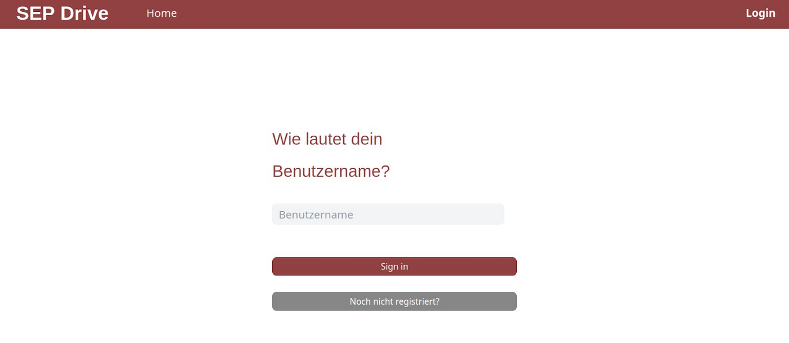
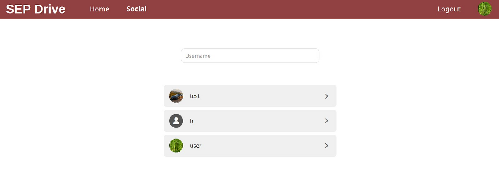
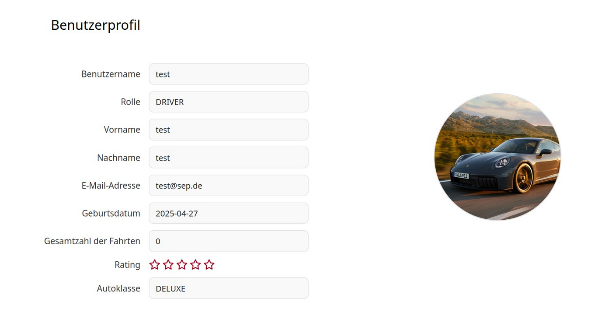
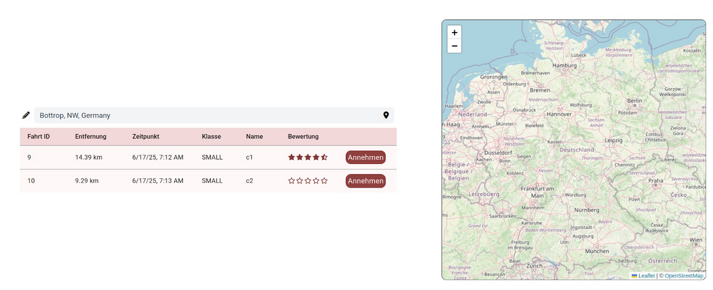
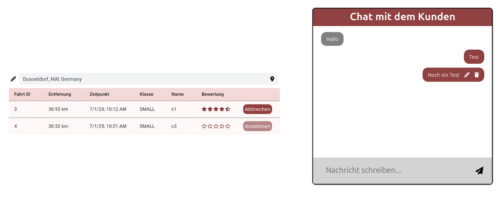
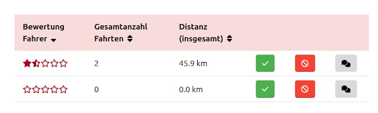

# SEP Drive

Eine Mitfahr-Web-App: Kunden erstellen Fahranfragen, Fahrer in der Nähe machen Angebote, beide chatten in Echtzeit, und die Fahrt wird live auf der Karte simuliert. Das Projekt ist im Sommersemester 2025 im Software-Entwicklungspraktikum (SEP) an der Universität entstanden, als Teamarbeit von acht Studierenden in drei Entwicklungszyklen.

**Stack:** Angular 19 · Spring Boot 3.4 (Java 21) · PostgreSQL · WebSockets (STOMP/SockJS) · JWT · Leaflet / OpenRouteService · Docker Compose

## Mein Beitrag

Die Namen und E-Mail-Adressen der anderen Teammitglieder wurden in der Git-Historie anonymisiert (`Contributor A` bis `G`). Meine eigenen Commits stehen unter meinem Namen und lassen sich mit `git log --author=nils` nachvollziehen.

| Zyklus | Feature | Umfang |
|---|---|---|
| I | **Login & Authentifizierung** | Auth-Service im Frontend (JWT), Login-Flow |
| I | **Navigationsleiste** | Abhängig vom Login-Status, mit Profilbild-Link |
| I | **Benutzerprofil** | Profilansicht für eigene und fremde Profile, User-Service |
| I | **Social Board** | Übersicht aller Nutzer mit Suche |
| II | **Fahrtangebote** | Backend und Frontend: Fahrer machen Angebote, Kunden nehmen sie an oder lehnen sie ab, Updates in Echtzeit |
| III | **Chat** | Frontend des Echtzeit-Chats zwischen Fahrer und Kunde (Bearbeiten und Löschen ungelesener Nachrichten) |

Außerdem war ich für mehrere Architektur-Artefakte verantwortlich (Komponenten-, Klassen- und Kommunikationsdiagramme) sowie für einige User Stories und Papierprototypen.

## Screenshots

**Login:** Anmeldung mit Benutzername und anschließender Passwort-Eingabe



**Social Board:** Alle Nutzer mit Suchfeld; ein Klick öffnet das Profil



**Benutzerprofil**



**Fahrer-Sicht:** Verfügbare Fahranfragen mit Entfernung zum eigenen Standort



**Fahrangebot und Chat:** Nach dem Angebot öffnet sich der Chat mit dem Kunden



**Kunden-Sicht:** Eingehende Fahrangebote (sortierbar), annehmen, ablehnen oder chatten



## Lokal starten

```bash
git clone https://github.com/nils3005/SEP-Drive.git
cd SEP-Drive
cp .env.example .env   # Werte eintragen
docker compose up -d
```

Frontend: http://localhost · Backend: http://localhost:8080

Für Routing und Geocoding braucht man einen kostenlosen API-Key von [OpenRouteService](https://openrouteservice.org/). Er wird in `sep-drive-frontend/src/environments/environment.ts` eingetragen.
